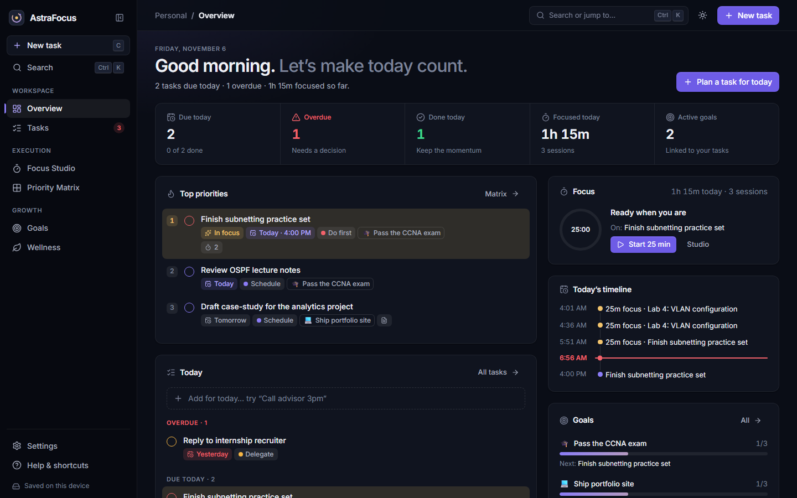

# AstraFocus

**Plan with clarity. Focus with intention. Make meaningful progress.**

AstraFocus is a calm productivity workspace that brings tasks, priorities, goals and deep-work sessions together in one place. It's keyboard-first on desktop and built for touch on mobile.



> Live (previous version): https://eskinder185.github.io/AstraFocusNexus/
> The live site still runs v0.2. The redesign on `feat/phase-1-foundation` has not been deployed yet.

## What it does today

- **Overview:** today at a glance, top priorities, a timeline of today's timed tasks and focus sessions, goal progress, and insights drawn only from your data.
- **Tasks:** natural-language capture (`Lab report thu 9am !1`), optional start and due dates with optional times (validated so a task can't be due before it starts), smart grouping (overdue, today, upcoming, no date), filters, a detail panel, and undo. Tasks with both a start and a due date appear on the Calendar as dashed schedule items.
- **Focus Studio:** a Pomodoro timer that survives navigation, refresh and sleep; linked tasks; atmospheres; distraction-free mode; ambient noise generated on-device.
- **Priority Matrix:** Eisenhower quadrants with drag-and-drop and a keyboard alternative.
- **Goals:** progress from the linked work you actually finish, the next action, and time invested.
- **Wellness:** an optional, private mood, stress and energy check-in with supportive, non-medical suggestions.
- **Command palette:** <kbd>Ctrl</kbd>/<kbd>⌘</kbd>+<kbd>K</kbd> to search, navigate, create tasks and control the timer.
- **Bring Your Own AI (optional):** connect a model on your own computer (Ollama, LM Studio, with a guided install) or your own cloud account (OpenAI or OpenAI-compatible), then break goals into tasks, plan your day and improve vague tasks. Every action previews what is sent and changes nothing until you apply it. Keys stay in memory only. See [AI assistant](docs/AI_CONNECTIONS.md).

All data stays in your browser on this device. Export it any time from Settings. Accounts and sync are on the [roadmap](docs/IMPLEMENTATION_ROADMAP.md).

## Development

Requires Node 20.19+.

```bash
npm install
npm run dev          # http://localhost:5173/AstraFocusNexus/
npm run typecheck
npm test             # unit tests (Vitest)
npm run build        # type check + production build → build/
npm run test:e2e     # Playwright against the production build (run `npx playwright install chromium` once)
```

Capture review screenshots with `SCREENSHOTS=1 npx playwright test screenshots`.

## Documentation

- [Audit](docs/ASTRAFOCUS_AUDIT.md): what was found, feature-by-feature status
- [Product vision](docs/PRODUCT_VISION.md)
- [Architecture](docs/ARCHITECTURE.md)
- [Implementation roadmap](docs/IMPLEMENTATION_ROADMAP.md)
- [AI assistant](docs/AI_CONNECTIONS.md): setup wizard, recommendations, privacy and browser limits
- [Local companion connector](docs/AI_COMPANION_CONNECTOR.md): design for restricted browsers (not implemented)

## Deployment

`npm run deploy` publishes `build/` to the `gh-pages` branch. Only deploy reviewed, tested builds.
